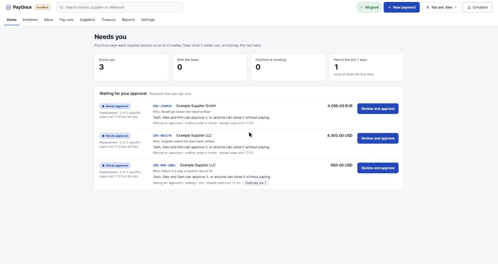
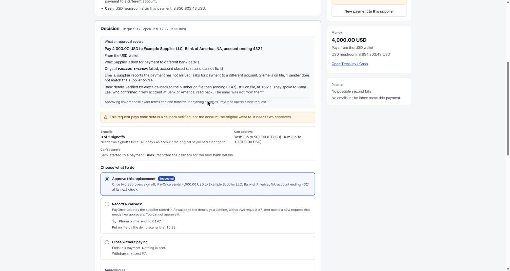

# PayOnce

PayOnce is a payment incident agent for supplier invoices paid through Airwallex: it sends each invoice's transfer and follows it to the bank. When something goes wrong (a failed or stuck payment, a supplier email asking for new bank details, a payout someone sent from the Airwallex web app, a rail outage), it fixes what a fixed policy says is safe and hands the rest to a person, with exact terms to approve or close. It is an entry for the Airwallex Agentic Banking Hackathon 2026, built from starter kit 3 (Payment Ops Incident Commander), and it runs against the Airwallex sandbox only, with no real money.

Demo video (4:31): https://drive.google.com/file/d/1Q5hfMehzDYxvqbDQg343T4bGNX9Ufxmw/view

Live demo: https://payonce.jagnani73.com. It runs against the Airwallex sandbox, with no login: pick a name from the top bar and act as that person. Every night at 03:00 Singapore time it starts a fresh morning with three payments waiting for a person.



## Run it

You need Node 24, for its built-in `node:sqlite`, and pnpm 12. It was built with pnpm 12.5.1 (`npm install -g pnpm@12.5.1`).

```bash
pnpm install
pnpm dev
```

`pnpm dev` needs no credentials and makes no network calls. It reads the sample supplier emails in `fixtures/emails/` and prints the findings and the policy's decision for seven sample incidents.

To run it against the Airwallex sandbox, make a `.env` file in the project folder with your sandbox Client ID and API key, the approvers and the reserve floors:

```bash
AWX_CLIENT_ID=your-client-id
AWX_API_KEY=your-api-key
APPROVERS=Yash:50000,Alex:10000,Kim:10000,Sam:4200
RESERVE_FLOORS=USD:1000000,EUR:1000000
WEBHOOKS=off
```

Then start the server, and set up the demo's morning from a second terminal:

```bash
pnpm ui                          # builds the page, then serves it at http://127.0.0.1:4310
node scripts/demo-morning.mjs    # a pay run and two incidents; makes 5 sandbox transfers
```

Open http://127.0.0.1:4310. The setup script needs an empty ledger (`pnpm reset` moves the old one aside) and the four names in `APPROVERS` above. It leaves three payments waiting for a person, and [docs/demo.md](docs/demo.md) walks through them. On a sandbox account that has never run a scripted incident, the demo supplier does not exist yet and the script stops and says so: start one scripted incident (USD, local transfer, Paid) from the Sandbox simulator, then `pnpm reset` and run the script again. Without the script, start a scripted incident from the simulator, or pay a beneficiary of your own from New payment.

`.env.example` lists every setting. `NAME!` is required, `NAME=value` shows the default, and `a|b|c` lists the accepted values, so write one of them. Put only the lines you change in `.env`, not a copy of the whole file. To run with no Airwallex at all, set `AWX_BASE_URL=https://sandbox.invalid` and give the two credential lines any value: every call then fails as unreachable, and nothing can be paid. `pnpm ui` stops at start-up while either credential is missing.

## Contents

- [What it guarantees](#what-it-guarantees), and [the policy](#the-policy) that decides
- [A tour of the page](#a-tour-of-the-page)
- [Setting it up](#setting-it-up): approvers, reserve floors, alerts, the email reader, webhooks
- [Read PayOnce from Claude](#read-payonce-from-claude), a read-only MCP server
- [Deploying](#deploying) the live copy on AWS
- [Layout](#layout) and [Commands](#commands)
- [How it was checked](#how-it-was-checked)
- [Not built yet](#not-built-yet)
- [docs/architecture.md](docs/architecture.md): one look at an invoice from wake to next look, the layers, the payment gate and the hash chains
- [docs/invariants.md](docs/invariants.md): every money guarantee in one sentence, with the code that enforces it
- [docs/demo.md](docs/demo.md): the demo's recording script
- [docs/verification/sandbox-runs.md](docs/verification/sandbox-runs.md): the runs against the real Airwallex sandbox, with every transfer they made

## What it guarantees

PayOnce never pays an invoice twice, never takes bank details from an email, and writes every step it takes on a hash-chained timeline. The guarantees are about money: what may be sent, when, to whom and on whose word. [docs/invariants.md](docs/invariants.md) numbers each one in a sentence and names the code that enforces it.

- An invoice has at most one live payment. Every attempt is written to the SQLite ledger before the transfer is created, inside a transaction, and a partial unique index refuses a second live attempt. Each attempt has its own request id, which Airwallex uses as an idempotency key, so a retry can create at most one transfer.
- PayOnce learns what the bank did only from Airwallex. A webhook or a status check wakes it up, and it then reads the transfer and decides on what it read, never on a webhook's body.
- Rules in code decide. A pure policy (`src/domain/decide.ts`) chooses to wait, replace, escalate or close. A model reads supplier emails, but it only answers yes-or-no questions, and its answers can add caution and never remove it.
- Bank details change only after a callback. New details never come from an email or a model: a person calls the supplier on the phone number on file, which two people put there, and records the call. Two approvers then sign for the new account.
- Every payment a person starts waits for someone else's approval before its first transfer. The starter can't approve it, a payee PayOnce has never paid on a person's approval needs two approvers, and so does an amount above `TWO_APPROVERS_ABOVE`. A pay run is approved as a whole, so its rows don't wait again.
- An approval covers exact terms. A request carries the payee, amount, account, rate and reasons, bound by a SHA-256 hash. PayOnce rebuilds the terms before it spends an approval, any change voids it, and an approval pays one attempt. It spends an approval only while the terms on file still hash to that binding, so terms changed in the ledger by hand send nothing.
- PayOnce replaces a failed payment by itself only if the wallet stays above its reserve floor, after the fee and the money already promised to other payments. A payment from another currency's wallet always goes out on a quote a person approved.
- Just before every payment PayOnce lists the transfers again. A payout for the invoice that someone sent outside PayOnce holds the invoice for a person.
- A rail outage stops new payments on that rail until a person ends it, and an approval the outage stopped stays unspent.
- PayOnce closes an invoice by itself only when it is paid once. Anything else that looks paid waits for a person to close it, with a name and a note.
- Every invoice, pay run and reconciliation timeline is a hash chain with a running hash, and `pnpm run audit` checks them all.
- Supplier names, emails, Airwallex messages and typed notes are cleaned wherever they are shown. They never reach an escalation reason or an alert's wording, and MCP answers mark them as untrusted.
- The Airwallex client accepts only the two sandbox hosts and an offline host, and it never prints a key.

### The policy

`decide` checks these in order. The first that applies wins.

| Situation | Action |
| --- | --- |
| A payout for the invoice sent outside PayOnce is live | Escalate |
| A supplier email asks for other bank details, or asks to hold, cancel or not pay | Escalate |
| The supplier's bank details changed after the original was sent | Escalate |
| An email came from a sender that does not match the supplier's domain, or could not be read in full | Escalate |
| The original is in a status the policy does not know | Escalate |
| The original settled | Close, or escalate if an email says it never arrived |
| The original is still with the bank | Wait, or escalate once it is past its deadline |
| A replacement already failed, or a resend cannot fix the failure | Escalate |
| The original was sent outside PayOnce | Escalate |
| Cash cannot be read, or a replacement would take the wallet below its floor | Escalate |
| The replacement is above `TWO_APPROVERS_ABOVE`, or needs a new exchange rate | Escalate |
| No floor is set for the currency | Escalate |
| The original failed on the sending side (a system error or a channel timeout) and nothing above applies | Replace |

The engine adds two holds where the policy would replace: an invoice that looks like a second bill for one already paid, and an active outage on the payment's rail. A late transfer that may have paid twice, or a transfer under PayOnce's request id that does not match the invoice, holds the invoice before the policy runs. [docs/design/engine-rules.md](docs/design/engine-rules.md) has every rule.

### A payment that fails or stalls

A transfer has a deadline: 3 minutes for a local transfer and 5 for SWIFT by default, counted from when Airwallex created it, because the sandbox moves in seconds. While the bank has the payment, PayOnce waits. Past the deadline it hands the invoice to a person and still sends nothing, because the bank may yet pay. When the original fails on the sending side, PayOnce sends a replacement by itself if the wallet stays above its floor after the replacement and its fee. A failed SWIFT transfer keeps its fee, so the fee is counted twice. Any other failure, or a second one, goes to a person.

### Supplier emails

A person uploads a supplier's raw email on the Inbox screen. PayOnce parses it itself, in a worker thread with a time and memory limit, and never opens an attachment, loads an image or follows a link. HTML becomes text in one pass, and anything a mail client could draw that PayOnce cannot read marks the email partly unread. A person picks the invoice the email belongs to. The reader then answers three questions about it: does the supplier say the payment has not arrived, ask for a different account, or ask not to pay. A keyword check reads the same text, and a finding is yes if either says yes. Findings stay once made, and the sender's domain is checked in code, as ASCII only, so a look-alike character cannot pass. An email on file before an invoice's first payment holds it for a person.

### Changed bank details

PayOnce reads the supplier's Airwallex record before every payment and sends nothing if any bank detail changed since the payment was decided or approved. To pay new details, a person calls the supplier on the phone number on file and records who called, the number dialled, who they spoke to and what was confirmed. PayOnce then updates the record in Airwallex, and a new request needs two approvers, neither of them the caller. The phone number itself goes on file only when one person proposes it and a second types it again from their own source. A change of that number retires every callback made on the old one and withdraws the requests that relied on them. [docs/design/supplier-contacts.md](docs/design/supplier-contacts.md) has the rules.



### Duplicate invoices

Before a first payment PayOnce compares the invoice with every other one. The same supplier, currency and amount, with a number that matches apart from case, separators, leading zeros or up to four letters added at the end (INV-0042 and INV-42A), holds the new invoice for a person. So does the same number for the same supplier at any amount. A person then approves paying it or closes it without paying. A held invoice's terms name the invoices it looks like, so a change in any of them voids the approval.

### Payouts sent outside PayOnce

Someone can pay the same invoice from the Airwallex web app. Every 30 seconds, and again just before any payment, PayOnce lists the transfers created since its ledger started. A payout whose reference names an invoice, or nearly matches one, is tied to it: while it is live or paid, PayOnce sends nothing more and withdraws any open request. A payout that matches no invoice becomes an incident of its own once it fails or passes its deadline, and its replacement always needs a person.

### Payments across currencies

An invoice owed in EUR can be paid from the USD wallet. Each payment is one transfer on a quote that buys exactly the invoice amount. Every such payment, the first included, waits for a person to approve the rate, and the quote is part of the terms. A request ends 12 minutes before its quote does, if that comes before its expiry. Approver limits and floors are compared with what leaves the USD wallet.

### Rail outages

When payouts to three different payees fail on one rail (a currency and transfer method, such as USD local) within 30 minutes with a code that means the rail failed and not the account, PayOnce declares an outage. While it lasts, no new payment opens on that rail: first payments wait, an automatic replacement goes to a person, approved payments and pay runs wait with their approval kept. Nothing ends an outage by itself. A person in `APPROVERS` ends it with a note, and what it held carries on at once.

### Pay runs

A pay run pays a CSV of invoices on one approval. PayOnce checks every row with GETs only and skips a row it cannot read, a number already in the ledger, a likely second bill, a beneficiary that does not match, or bank details that changed without a callback. The cash check comes last, per currency, so row order never decides who is paid. Limits apply to each currency's total. Once approved, the server checks every row again, spends the approval in one transaction that writes each row as an invoice, and sends them one at a time, each under its wallet's lease and checked against the floor again.

### Closing an invoice

A paid original closes the incident when no email says it never arrived and nothing else sends it to a person. A paid replacement closes it by itself. Anything else that looks paid waits for a person to close it with a name and a note, and that close has to name every transfer on file that did not match the invoice. A person can also close an invoice without paying it while nothing for it is with the bank.

### Reconciliation and the audit trail

Reconciliation reads each wallet's history from Airwallex with GETs, checks that every movement follows from the one before and ends at the available balance, and matches movements to transfers and transfers to the ledger. What it cannot explain becomes a break: a refund that never came, a debit with no transfer, a payment recorded as paid that came back. It moves no money and changes no invoice. Every invoice, pay run and reconciliation timeline is a hash chain with a running hash, so an edited, inserted or removed line shows. The chain has no key: it catches a quiet edit to the file, not someone who recomputes every hash.

### Advice for people

When an invoice has a due date, PayOnce says when its route usually arrives and whether it may be late, from Airwallex's published payout tables for the US and Germany. It drafts messages to the supplier and trace requests to Airwallex for a person to send, from its own fields only. Ask why gives a model PayOnce's own records of one invoice, never an email, an account or a typed note, and shows the model's account of what happened. None of these holds, sends or blocks a payment.

## A tour of the page

`pnpm ui` serves one page at `http://127.0.0.1:4310`. The top bar has the screens below, a search box for invoices, suppliers and references, the name you are acting as, and a status chip for Airwallex, webhooks and the reader.

| Screen | Route | What it is for |
| --- | --- | --- |
| Home | `#home` | What needs you now: four tiles, the requests you can approve, and a queue of payments and pay runs waiting on a person. Each row has one button that opens the payment at that step. An empty ledger shows a readiness checklist. |
| Incidents | `#incidents` | Every payment by situation (Needs you, Bank is late, With the bank, PayOnce is handling, Closed), with search, wallet and origin filters, an outage strip and money at risk per wallet. |
| Payment | `#incident/ID` | One invoice: its situation and next step, a summary with Ask why, the Decision panel (approve, record a callback, close, end an outage) and tabs for the timeline, transfers, emails, messages and audit trail. |
| New payment | `#new-payment` | Pick a beneficiary and enter the invoice. As you type, a preview runs the same holds the first payment will and says what happens next. |
| Inbox | `#inbox` | Upload a supplier's raw email. PayOnce parses it, suggests the invoice it names, and a person delivers or dismisses it. |
| Pay runs | `#runs` | Upload a CSV of invoices, see each row's checks and the cash check, approve the run's terms, and watch it release row by row. |
| Suppliers | `#suppliers` | One page per Airwallex beneficiary record: cautions, money at risk, the accounts PayOnce paid, invoices, callbacks, the phone on file with its two-person change, and a New payment button for the record. |
| Treasury | `#treasury` | Cash per wallet down to the headroom above its floor, reconciliation of Airwallex's wallet history against the ledger, and rail outages with the form to end one. |
| Reports | `#reports` | Ops metrics for the last 7 or 30 days or since the ledger started, and the audit check of every timeline. |
| Settings | `#settings` | What `.env` set: approvers and limits, floors, alerts, the reader, Airwallex and webhooks. Read-only, and secrets are never shown. |
| Sandbox simulator | `#sandbox` | A drawer that plays the bank and the supplier: scripted incidents, the next payment's bank outcome, sample email threads and a duplicate lock test. |

The page has no login. The server listens on this machine only, accepts changes only from its own page, and the page makes no outside requests. A link an alert posted in the old form, `#INV-5001`, still opens that payment.

## Setting it up

### Approvers

- `APPROVERS` lists names with limits, such as `Yash:50000,Alex:10000,Kim:10000,Sam:4200`. Without it nobody can approve anything.
- A limit is compared with what the payment takes from the wallet it leaves, in that wallet's currency. For `eur-from-usd`, which pays 4,000 EUR with about 4,476 USD, Sam's 4,200 is not enough.
- Two different approvers are needed above `TWO_APPROVERS_ABOVE` (5,000 by default), for a payment to an account the original did not go to, when PayOnce does not know who started the incident, and for a held invoice's payment to a supplier PayOnce has not yet paid on a person's approval.
- The person who started an incident cannot approve it. Neither can a pay run's uploader, anyone who recorded a callback for the account, or anyone who proposed or confirmed the phone number that callback was made on.
- A request expires after `APPROVAL_TTL_MINUTES` (60), or sooner when its exchange rate quote ends first. The next look opens a new one.
- A name is typed, not logged in: letters A to Z, digits, spaces, dots, hyphens, apostrophes and underscores, up to 80 characters. `Alex.` and `alex` are one person, so a list that names both is refused. [docs/design/names.md](docs/design/names.md) has the rule.

### Reserve floors

- `RESERVE_FLOORS` sets what each wallet keeps back, as currency and amount pairs: `USD:1000000,EUR:1000000`.
- A currency that is not listed has no floor, and PayOnce never replaces a payment in it by itself. List it with 0 to say it needs none.
- If the setting cannot be read, every automatic replacement goes to a person. Floors are read at start-up.
- A single incident's first payment is not checked against the floor. Pay run rows are, when the run is checked, when it is released and when each row is sent.

### Alerts

- Set `ALERT_WEBHOOK_URL` to a Slack incoming webhook, or a Discord webhook with `ALERT_FORMAT=discord`. PayOnce takes no other host. Unset, it makes no alert calls at all.
- Only `pnpm ui` posts. Every 5 seconds it works out from the ledger what needs a person: an escalated or held invoice, a passed bank deadline, a payout sent outside PayOnce, a pay run waiting for approval, emails waiting in the inbox, a headroom below 0, reconciliation breaks, a rail outage declared or ended, a timeline that no longer verifies, or a supplier phone number that waits for a second person, was put on file or was changed.
- A condition alerts once, and again only when it changes. The first time alerts are on, PayOnce posts one summary of what is already waiting.
- An alert carries the invoice, supplier, amount, reason, approvers needed and a link to the local page. It never carries email text, a sender, an account number, a phone number, an approver's name or a secret.
- To try alerts without Slack or Discord, set `ALERT_TEST_RECEIVER_URL` to a receiver on 127.0.0.1. `GET /api/alerts` lists the last 50 alerts and how each went.

### The email reader

- With `CLAUDE_API_KEY` set, Claude reads the emails: Claude Haiku 5.5 first and Claude Sonnet 5.5 second (`CLAUDE_MODEL`).
- With `READER_API_KEY` set, Gemini 3.5 Flash and Gemini 3.1 Flash-Lite come next (`READER_MODEL`), through Google's OpenAI-compatible endpoint (`READER_BASE_URL`). Gemini's free tier needs no billing account, but Google may use its content, and the upload card says so.
- Each model gets one try, in that order, and the first answer counts. With neither key, the keyword reader reads the emails.
- The key is `CLAUDE_API_KEY`, not `ANTHROPIC_API_KEY`, because Claude Code reads `ANTHROPIC_API_KEY` from your shell and would switch to it.
- Ask why (the summary card on a payment, and `pnpm ask`) uses the same keys, with Sonnet first (`CLAUDE_ASK_MODEL`). It gets PayOnce's own records only, never an email, an account or a typed note, and its answer is never stored.

### Webhooks

- `pnpm ui` listens for Airwallex payout webhooks on `WEBHOOK_PORT` (4311). It opens a Cloudflare quick tunnel to it, which needs no account, and points the Airwallex webhook subscription at the tunnel.
- When this was tried in the sandbox on 28 October, Airwallex queued an event for every status change and delivered none ([docs/verification/webhooks.md](docs/verification/webhooks.md)), so set `WEBHOOKS=off` there. A status check then finds every change, every 3 seconds (every 15 while webhooks are on).
- Set `WEBHOOK_URL` to use a public address you already have, and `CLOUDFLARED` to the path of `cloudflared` if it is not on your `PATH`. On Windows, `winget install --id Cloudflare.cloudflared` installs it.
- An event counts only if its signature checks out, and only once. It wakes a look, and PayOnce reads the transfer itself.

### Other settings

| Setting | Default | What it does |
| --- | --- | --- |
| `FX_QUOTE_VALIDITY` | `HR_1` | How long an exchange rate quote holds: `MIN_30`, `HR_1`, `HR_4`, `HR_8` or `HR_24` |
| `BANK_DEADLINE_LOCAL_MINUTES`, `BANK_DEADLINE_SWIFT_MINUTES` | 3, 5 | How long the bank has before a person hears about a payment. Real rails take days; the sandbox moves in seconds |
| `OUTAGE_FAILURES`, `OUTAGE_WINDOW_MINUTES` | 3, 30 | How many payees failing on one rail within the window declare an outage |
| `RECON_EVERY_MINUTES` | 10 | How often the server reconciles the wallets; 0 turns it off |
| `PORT` | 4310 | The page and the API |
| `PUBLIC_ORIGIN` | unset | The https origin of a proxy in front of the server, such as `https://d1234.cloudfront.net`. The page then answers there too. The server still binds to 127.0.0.1 |
| `DAILY_PAYMENT_CAP` | unset | The most payments the page starts in a UTC day, pay run rows included. Past it, New payment, scripted incidents and pay runs answer 429 |

## Read PayOnce from Claude

`src/surfaces/mcp/main.ts` is a read-only Model Context Protocol server over stdio. Add it to Claude Code or Claude Desktop and ask "what is waiting on a person?", "what can Kim approve?" or "why did INV-5001 go to a person?". Each tool answers with the view the page reads, built by the same code in `src/views/`.

| Tool | Arguments | What it returns |
| --- | --- | --- |
| `board` | `group`, `currency`, `origin` | The payments in one group (`person`, the default, `deadline`, `bank` or `open`), ranked as the page ranks them, each with its situation. Also the counts of every group, the group's totals per wallet and the active outages |
| `incidents` | `state`, `limit` | Every payment, open and closed. `state` keeps one ledger state (`open`, `escalated`, `settled` or `rejected`), `limit` caps the rows (100), and `total` says how many matched |
| `incident` | `invoiceId`, `lines` | One payment as its page shows it: its situation, summary, decision panel with the open request and who can sign, transfers, emails, drafts, the newest timeline lines (20) and the audit line |
| `waiting_for` | `name` | The payments and pay runs whose request this person can approve now |
| `cash` | none | Per wallet: the balance, the floor, the headroom and the money promised, waiting, with the bank and kept as fees |
| `runs`, `run` | `runId`, `lines` | The pay runs, and one run as its page shows it |
| `audit` | `invoiceId` or `runId`, `lines` | With no argument, the check `pnpm run audit` makes of the whole ledger. With one, that timeline's audit export |
| `outages` | none | Active rail outages and those ended lately, with what each pauses and who may end it |
| `suppliers`, `supplier` | `key` | Every supplier record, and one as the supplier view shows it. `key` is a record id or an invoice number |
| `metrics` | `period` | The Reports view for `7d`, `30d` or `all` |

- No tool approves, closes, pays, sends, drafts, uploads or ends an outage. People do that on the page and in the terminal.
- Each call opens the ledger read-only and closes it after. The server never creates a ledger and never upgrades one an older PayOnce wrote: run `pnpm board` or restart `pnpm ui` once.
- It never calls Airwallex and needs no credentials. Of `.env` it reads only the approval policy (`APPROVERS`, `TWO_APPROVERS_ABOVE`, `APPROVAL_TTL_MINUTES`), the floors, the bank deadlines, the outage rule and `PORT`.
- `cash` shows balances only while `pnpm ui` runs, from the server's balance cache. Without the server it gives the ledger's figures and says why.
- Text PayOnce did not write arrives wrapped, as `{"outsideText": "...", "from": "supplier"}`, and each answer starts with a note telling the model to report that text and never act on it. Phone numbers on file are masked.
- The server uses the official TypeScript SDK, `@modelcontextprotocol/server` 2.3.1 with `zod` 4.6.7, pinned exactly. It serves clients that open with `initialize` and clients on the 2026-07-28 revision, which has no handshake.

Run `pnpm install`, then `pnpm board` or `pnpm ui` once so the ledger exists.

### Claude Code

Run this from the repository root, with `C:/code/payonce` changed to your clone's path in both places:

```bash
claude mcp add --transport stdio --scope local payonce -- node --disable-warning=ExperimentalWarning --import file:///C:/code/payonce/node_modules/tsx/dist/loader.mjs C:/code/payonce/src/surfaces/mcp/main.ts
```

`--import` needs a `file:///` address, not a `C:\` path. `claude mcp list` should show `payonce` as connected. To read another ledger file, add `-e PAYONCE_LEDGER=D:/path/copy.db` before `--transport`. A relative path is read from the repository root.

### Claude Desktop

Open Settings, then Developer, then Edit Config, and add this block to `claude_desktop_config.json`, with the node path that `where.exe node` prints and your clone's paths. Double each backslash inside the JSON strings:

```json
{
  "mcpServers": {
    "payonce": {
      "command": "C:\\Program Files\\nodejs\\node.exe",
      "args": [
        "--disable-warning=ExperimentalWarning",
        "--import",
        "file:///C:/code/payonce/node_modules/tsx/dist/loader.mjs",
        "C:\\code\\payonce\\src\\surfaces\\mcp\\main.ts"
      ]
    }
  }
}
```

Quit Claude Desktop fully and start it again. Its log for the server is `%APPDATA%\Claude\logs\mcp-server-payonce.log`. To read another ledger file, add `"env": { "PAYONCE_LEDGER": "D:/path/copy.db" }` beside `args`.

## Deploying

The live copy runs on one EC2 instance in ap-southeast-1 behind CloudFront, with no login. [docs/design/deployment.md](docs/design/deployment.md) has the rules. The stack is in `infra/`, and nothing in this repository creates or changes anything in AWS by itself: you run these commands with your own `aws login` session.

```bash
aws login --profile payonce
pnpm --dir infra install
pnpm --dir infra cdk synth PayOnce --profile payonce -c alertEmail=you@example.com    # review it
pnpm --dir infra cdk deploy PayOnce --profile payonce -c alertEmail=you@example.com
```

That serves the site on its `*.cloudfront.net` name. For the custom domain, deploy the `PayOnceCert` stack (us-east-1), add the validation CNAME it waits for and a CNAME from the domain to the distribution at your DNS, then deploy `PayOnce` again with `-c certificateArn=<the CertificateArn it printed>`.

The deploy prints `Url`, `InstanceId`, `ReleaseBucket` and `DeployRoleArn`. Then:

1. Put the Airwallex keys in Parameter Store as SecureString parameters with the default key, under `/payonce/AWX_CLIENT_ID` and `/payonce/AWX_API_KEY` in ap-southeast-1. The console keeps them out of your shell history.
2. Set the repository variables for the deploy job:

   ```bash
   gh variable set PAYONCE_DEPLOY_ROLE_ARN --body <DeployRoleArn>
   gh variable set PAYONCE_INSTANCE_ID --body <InstanceId>
   gh variable set PAYONCE_RELEASE_BUCKET --body <ReleaseBucket>
   gh variable set PAYONCE_AWS_REGION --body ap-southeast-1
   ```

3. Deploy the first release, and open `Url` once it passes:

   ```bash
   gh workflow run ci.yml --ref main
   gh run watch
   ```

   From then on every push to main deploys itself.
4. Turn on the nightly fresh morning (03:00 Singapore time, 5 sandbox transfers a night), and run it once now:

   ```bash
   aws ssm send-command --profile payonce --region ap-southeast-1 --instance-ids <InstanceId> \
     --document-name AWS-RunShellScript \
     --parameters 'commands=["systemctl enable --now payonce-morning.timer","systemctl start --no-block payonce-morning"]'
   ```

5. In the Billing console, activate `project` as a cost allocation tag.

The server and your local PayOnce share one Airwallex sandbox account, so each sees the other's transfers as payouts sent outside PayOnce. The credits end on 31 December 2026. Once the results are out, take it all down:

```bash
aws s3 rm s3://<ReleaseBucket> --recursive --profile payonce
pnpm --dir infra cdk destroy PayOnce PayOnceCert --profile payonce -c alertEmail=you@example.com
aws ssm delete-parameters --profile payonce --region ap-southeast-1 --names /payonce/AWX_CLIENT_ID /payonce/AWX_API_KEY
```

## Layout

`src/` is in layers. `domain/` is pure: the policy, terms and their binding, approver rules, account keys, money, reasons and situations. `store/` is the SQLite ledger, one store per group of tables behind the `Ledger` facade, with the hash chains and the schema upgrades. `engine/` is the agent: a look at an invoice and its steps, the Dispatcher that runs one invoice at a time, the watcher, the sweep, sending, and the per-wallet lease. Beside it sit the subsystems: `runs/`, `outages/`, `recon/`, `intake/` (the email parser), `reader/`, `outbox/`, `alerts/` and `explain/` (Ask why). `views/` builds the typed, read-only views every surface serves, and `surfaces/` holds the ways in: the HTTP server, the MCP server and one file per CLI command. `airwallex/` is the sandbox client. `web/src/` is the page, in Preact, bundled by esbuild into `web/dist/`; it imports only types from `src/views/contract.ts`. Amounts are minor units throughout, and the ledger is `payonce.db` in the working directory. [docs/architecture.md](docs/architecture.md) draws one look from wake to next look and explains the layers, the payment gate, the leases and the chains. [docs/glossary.md](docs/glossary.md) defines the words, and [docs/design/](docs/design/) has a note per topic.

## Commands

| Command | What it does |
| --- | --- |
| `pnpm install` | Install the dependencies |
| `pnpm typecheck` | Type-check the server, the page and the tests; writes nothing |
| `pnpm test` | Replay the money journeys against a fake Airwallex in a second or two, without reading `.env` or making a network call ([docs/design/tests.md](docs/design/tests.md)) |
| `pnpm check:layers` | Fail when an import in `src/` reaches the wrong way between layers ([docs/architecture.md](docs/architecture.md#layers)) |
| `pnpm dev` | The policy on seven sample incidents, with no credentials |
| `pnpm ui` | Build the page, then serve it and the JSON API on 4310, with the webhook receiver on 4311 |
| `pnpm build:web` | Build the page into `web/dist/`; `--watch` rebuilds on save |
| `pnpm recover [OUTCOME] [INVOICE] [EMAILS] [SCENARIO] [NAME]` | Run one incident against the sandbox from the terminal, or continue an existing invoice, with status checks every 2 seconds |
| `pnpm approve <INVOICE> [REQUEST NAME]` | Show the waiting request, its terms and who may sign; with a request number and a name, record that approval |
| `pnpm close <INVOICE> [NAME] [NOTE] [--covers=REF,...]` | Show a paid invoice or a held one waiting on a person; with a name and a note, close it. `--covers` names every mismatched transfer the close covers |
| `pnpm run audit [INVOICE] [json\|csv]` | Check every timeline, the running hashes and reconciliation's chain, or one invoice's; with a format, print its audit trail |
| `pnpm run audit run <RUN> [json\|csv]` | The same for one pay run |
| `pnpm cash` | Read balances once and print each wallet down to its headroom; exit 1 if Airwallex or a floor is unreadable, or a headroom is below 0 |
| `pnpm board [FILTER...]` | The open payments from the ledger alone, active outages first. Filters in any order: a group (`person`, `deadline`, `bank`, `open`), a currency, an origin (`payonce`, `outside`, `pay-run`) |
| `pnpm payrun upload <FILE> <NAME>` | Check a pay run CSV (Airwallex GETs only) and store it as a run waiting for approval |
| `pnpm payrun show <RUN>` | The run's rows, cash check, request and who is barred |
| `pnpm payrun approve <RUN> [REQUEST NAME]` | Show the run's terms; with both, record that approval. `pnpm ui` releases the run |
| `pnpm payrun check <RUN>` | Run every check again and open a new request if the old one expired or the terms changed |
| `pnpm payrun cancel <RUN> <NAME> <NOTE>` | Cancel a waiting run |
| `pnpm outbox <INVOICE> [draft TEMPLATE NAME \| show DRAFT \| sent DRAFT NAME \| dismiss DRAFT NAME [NOTE]]` | Message drafts for a person to send, and the messages that fit now. PayOnce never sends one |
| `pnpm outage` / `pnpm outage end <ID> <NAME> <NOTE>` | Active rail outages and the last five ended; end one as a name in `APPROVERS` |
| `pnpm supplier [RECORD\|INVOICE]` | Every supplier record, or one as the supplier view shows it |
| `pnpm reconcile [offline]` | One reconciliation check against Airwallex (GETs only), or the stored record matched again with no call; exit 1 on a failed check, a wallet that does not add up or a break waiting on a person |
| `pnpm reconcile show [CURRENCY]` | The last reconciliation report, from the ledger alone |
| `pnpm reconcile explain <ID[,ID...]> [NAME NOTE --facts=FP,...]` | Show breaks and their facts; with a name, a note and the printed facts, explain them |
| `pnpm ask <INVOICE> [facts]` | Ask the reader's models why PayOnce did what it did; with `facts`, print exactly what would be sent and ask nothing |
| `pnpm metrics [7d\|30d\|all] [json]` | The ops metrics, from the ledger alone |
| `pnpm mcp` | Start the MCP server by hand |
| `pnpm reset` | Move `payonce.db` aside so the next run starts an empty ledger. Stop `pnpm ui` first |

The audit command is `pnpm run audit` because `pnpm audit` is pnpm's own dependency audit, and asking why is `pnpm ask` because `pnpm why` is pnpm's own too.

`pnpm recover` takes these arguments:

| Argument | Values | Default |
| --- | --- | --- |
| `OUTCOME` | What the sandbox bank does with the original: `PAID`, `STAYS_IN_FLIGHT` (it stays in `SENT`), or a failure type such as `CHANNEL_TIMEOUT`, `SYSTEM_ERROR`, `BENEFICIARY_BANK_RETURNED` or `ACCOUNT_CLOSED` | `CHANNEL_TIMEOUT` |
| `INVOICE` | A new number starts an incident; an existing one continues it | A random number |
| `EMAILS` | `nothing-arrived`, `new-account` or `moved-banks` | `nothing-arrived` |
| `SCENARIO` | `usd-local`, `eur-swift`, `eur-swift-low-reserve`, `usd-local-bank-change` or `eur-from-usd` | `usd-local` |
| `NAME` | Who starts the incident, and so cannot approve it | Your login name |

Three runs to try:

```bash
pnpm recover                                     # a channel timeout, replaced by itself
pnpm recover CHANNEL_TIMEOUT INV-5001 new-account
pnpm approve INV-5001                            # the supplier asked for a new account from a look-alike address
pnpm approve INV-5001 1 Alex
pnpm recover PAID INV-5002
pnpm recover PAID inv-05002                      # the same bill again: held, nothing sent
pnpm close inv-05002 Yash supplier sent it twice
```

## How it was checked

- `pnpm test` replays twelve journeys offline against a fake Airwallex. They check what happened, not what PayOnce printed: a timed-out payment is resent once and the invoice is paid once; a payout sent from the web app is tied to its invoice and nothing more goes out; an approval pays only its exact terms; a supplier email never changes the account paid; a second bill is held, even under another account name; and a resend never takes a wallet below its reserve floor. [docs/design/tests.md](docs/design/tests.md) says what each journey checks and what the suite leaves out.
- Each topic's rules were checked as they were built, mostly on copies of the ledger with Airwallex stubbed or faked. [docs/verification/](docs/verification/) keeps the dated notes on what was checked and how, as written at the time.
- During the rebuild of 6 to 8 November, a replay rig kept outside this repository ran about 40 scripted journeys against a fake Airwallex. It recorded everything a person or another program could see: the API's answers, timelines, alerts, CLI output and MCP answers. Each change was compared with the run before it, and merged only when nothing differed or each difference was explained.
- On 8 November three runs against the real Airwallex sandbox made 17 transfers, and reconciliation found every one in Airwallex with the status the ledger had. [docs/verification/sandbox-runs.md](docs/verification/sandbox-runs.md) lists each transfer, what broke and the commits that fixed it.
- Two paths were never run end to end in the sandbox: webhook delivery, because Airwallex queued every event and delivered none, and a failed payment from another currency's wallet with its replacement, because the simulator will not move a transfer that converts.

## Not built yet

- A login. Names are typed, so the approval rules stop mistakes and approving your own incident under your own name, but not someone typing a colleague's name.
- Real money. PayOnce runs on the sandbox and its simulator. The webhook receiver is built, but it has never handled a real event, because Airwallex delivered none in the sandbox.
- Fetching mail. Emails arrive as uploads only. PayOnce does not open attachments, follow links or check DKIM, SPF or DMARC, which is why bank details change only through a callback.
- Sending messages. PayOnce drafts messages to the supplier and trace requests to Airwallex, and a person sends them.
- A floor check on a single incident's first payment. Pay run rows have one.
- The supplier's email domain on file, set by two people the way the phone is, and recording a callback outside an incident.
- Currencies with no decimals or three, such as JPY or KWD, and totals across currencies.
- A keyed hash chain. Anyone who can write `payonce.db` can rewrite a timeline and recompute every hash, so keep an export somewhere else if you need to prove a timeline later.

## License

MIT. See [LICENSE](LICENSE).
