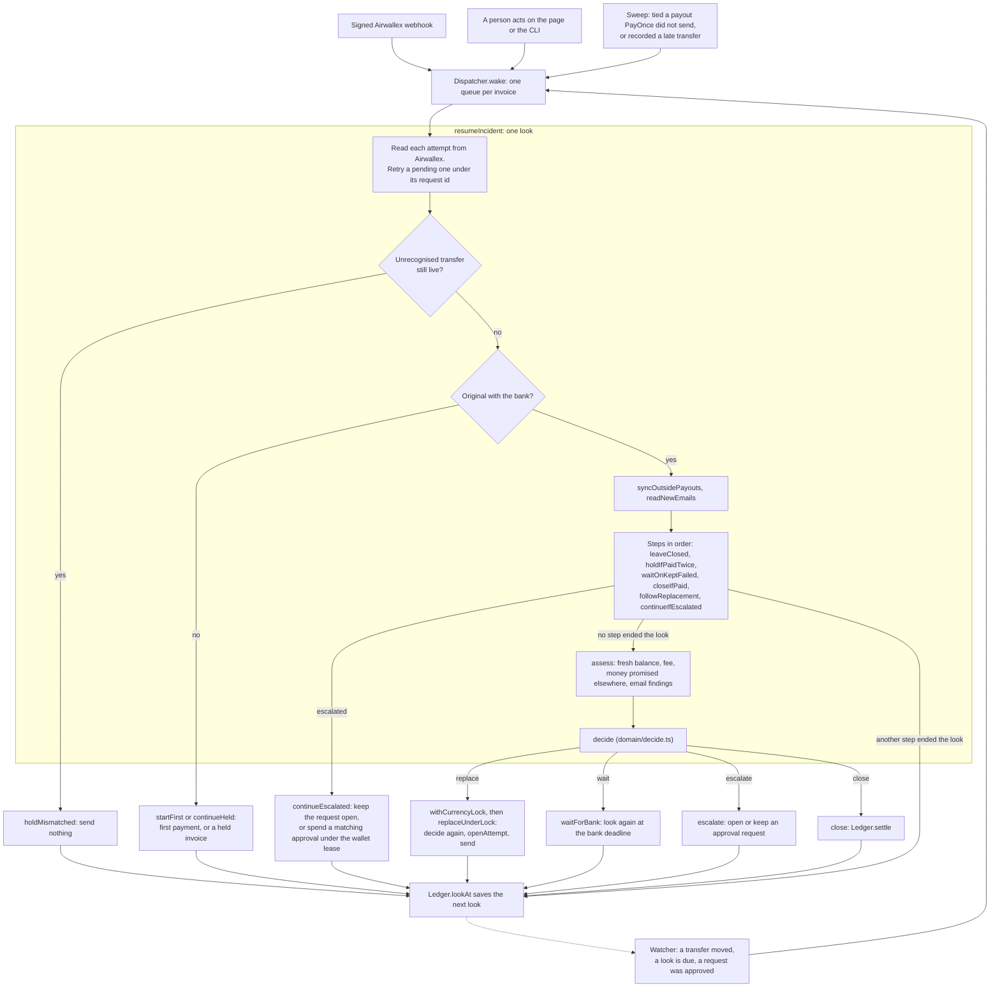

# Architecture

PayOnce pays supplier invoices through the Airwallex sandbox and deals with what goes wrong after the first transfer: a payment that fails or sits at the bank, a supplier email, a payout someone sent outside PayOnce, a rail outage. A fixed policy in code decides each step, and anything the policy will not do by itself goes to a person, who approves exact terms or closes the invoice.

[invariants.md](invariants.md) lists the money guarantees and where each is enforced, [glossary.md](glossary.md) defines the words, and the topic notes in [design/](design/) give the full rules for each area.

## One look

PayOnce works an invoice in looks. A look reads what Airwallex has for the invoice, runs its steps in a fixed order, asks the policy what to do, does it, and saves when the next look is due. Nothing keeps an invoice in memory between looks.

The look is in `src/engine/look.ts`. `resumeIncident` runs it, saves the next look with `Ledger.lookAt`, and on an error moves a due look a minute on, so a failing look is retried once a minute. `look()` reads the payments, then hands over to the steps in `SENT_STEPS`. Each step is a plain function that awaits nothing itself, so every await of a look sits in `look()` in a fixed order, and a look interleaves with other looks and the sweep the same way every time. The order matters: an unrecognised transfer is held before any retry, outside payouts are listed again before every payment, and a payment that may be paid twice holds the invoice before the policy runs or a close happens.

The policy is `decide` in `src/domain/decide.ts`. It is a pure function from an `Incident` (in `src/domain/incident.ts`) to one of four actions: wait, replace, escalate or close. `assess` in `src/engine/assessment.ts` builds the `Incident` from a fresh balance read, the fee on the transfer just fetched, the money promised to other payments (`committedMinor`) and the stored email findings.

## Layers

`src/` is split by what a module may do. `pnpm check:layers` runs `scripts/check-layers.mjs`, which fails when an import reaches the wrong way. The table starts at the bottom layer, and each layer imports only from the rows before it, as its last column says.

| Layer | Holds | Imports at runtime |
|---|---|---|
| `domain/` | The policy, terms and bindings, approver rules, account keys, money, reasons, the tests for what is live, the email facts and the sender check, situations. No I/O of its own: a few functions, such as `likelyDuplicates`, read a `Ledger` passed in. | Nothing of ours. Row types from `store/`, Airwallex payloads and subsystem records come in as `import type`. |
| `text/` | Printing and cleaning text for a terminal, secret redaction, fixed words, the UTC formatter. | `domain/`. |
| The email parser | `intake/eml.ts`, `html-text.ts`, `css-text.ts` and `parse-worker.ts`: a raw email in, its text out. It sits beside `text/`, so the Airwallex client and the readers can clean text with `cleanLine`. | `domain/` and `text/`. |
| `store/` | The SQLite ledger: one `Db` connection, one store class per group of tables, the hash chains, the schema and its upgrades, and the shapes stored JSON is checked against (`store/stored.ts`). `store/ledger.ts` is the `Ledger` facade the rest of the code uses. `store/read/` holds the read-only helpers built on it: the cash lines (`cash.ts`), an invoice's facts (`facts.ts`), what a person reads before a close or an approval (`reviews.ts`), the callback facts, and the metrics, search and supplier reads. | `domain/`, `text/` and the parser. |
| `airwallex/` | The HTTP client and one module per API area. | `domain/money.ts`, `text/`, and `cleanLine` from the parser. |
| `engine/` | The agent: the look and its steps, the `Dispatcher`, the watcher, the sweep, sending, the currency lock, the sandbox bank. | The rows before it, and the `outages/` and `reader/` subsystems. |
| `runs/`, `outages/`, `recon/`, `intake/`, `reader/`, `outbox/`, `alerts/`, `explain/` | Pay runs, rail outages, reconciliation, the upload queue, the email readers, message drafts, alerts and Ask why. They sit beside the engine. | The rows before the engine, and each other and the engine one way only. `runs/` and `intake/` use the engine, and the engine uses `outages/` and `reader/`. |
| `views/` | Typed, read-only view builders and the view contract (`views/contract.ts`). They write nothing. | Every row before them but the engine. They read Airwallex with GETs only, for the beneficiary picker and the New payment preview. |
| `surfaces/` | `http/` (the server, its routes and the webhook receiver), `mcp/` (the read-only MCP server) and `cli/` (one file per command). | Anything. |
| `settings.ts`, `env-file.ts` | Every environment setting, read once by `loadSettings`, and the `.env` loader. `engine/create.ts` `createEngine` builds the `Engine` from the settings. | Anything. |

Layers that sit beside each other (`text/` and the parser, the store and the Airwallex client, the engine and its subsystems) may import each other in one direction only, and the check fails on a cycle among them. A type-only import may also name a row, an Airwallex payload, a subsystem's record or the settings from any layer, but it never reaches into the engine, the views or a surface.

Settings reach the code as arguments, and nothing keeps a loaded copy. The `Engine` carries the approval policy, the reserve floors, the bank deadlines, the quote validity and the outage rule, and callers hand reconciliation and Ask why the settings they read. The views take the bank deadlines and the outage rule from the `Settings` they are built with, and the outbox takes the deadlines from its caller. The sandbox route hands its view the scripted incidents, which live in `engine/scenario.ts`. Alerts get the situations they alert on from a reader the server passes in (`SnapshotsOf`), which loads them the way the views do.

The check allows one exception, with its reason in the script:

- `views/payment-check.ts` imports `engine/first-payment.ts` and `engine/new-payment.ts`. The New payment preview runs the same outage gate, holds and payee check as `startPayment`, on facts read without a lease, so it says what the start would do.

The engine and the policy never read the views, reconciliation, metrics, the supplier view, Ask why or the MCP server. Those read the ledger and move no money.

## The payment gate

Every payment attempt opens in one place: `AttemptStore.openAttempt` in `src/store/attempts.ts`, reached as `Ledger.openAttempt`. It runs only inside a write transaction and before Airwallex is called. In that transaction it:

1. throws unless the caller's wallet lease is still held (`LockStore.requireLease`) and is the lease of the wallet the invoice pays from;
2. throws `RailOutageError` if the invoice's rail has an active outage, which rolls back the caller's transaction, so an approval it would have spent stays approved;
3. copies the quote and the account key from the terms of the approval the payment is opened on, or takes the account the agent decided on, and refuses a cross-currency payment with no approved quote;
4. inserts the attempt through the private `insertAttempt`, which refuses while `LIVE_ATTEMPT` finds a live payment for the invoice. The partial unique index `one_live_attempt_per_invoice` (in `store/schema.ts`) backs it up. Both raise `DuplicatePaymentError`.

The attempt row holds a fresh `request_id`, the `approval_id`, the quote, `account_key` and `route_key`. Four callers open attempts: `startPayment` (a first payment) in `engine/first-payment.ts`, `replaceUnderLock` (an automatic replacement) in `engine/replacement.ts`, and `useApproval` (an approved replacement) and `releaseFor` (a held invoice's first payment) in `store/approvals.ts`. The last two spend the approval in the same transaction. `tryLock`, behind the demo's Pay again, calls `insertAttempt` too but always rolls back.

The transfer itself is created only by `sendAttempt` in `engine/payments.ts`, the one caller of `createTransfer`. It sends the attempt's `request_id` as Airwallex's idempotency key, so retrying an attempt can create at most one transfer. A 4xx other than 429 fails the attempt, with the exceptions [invariants.md](invariants.md) lists. Any other error leaves it pending for a later look to retry under the same id. When a transfer is recorded, the account and rate checks (`transferChecks` in `engine/send.ts`) run in the same transaction.

## Leases and the fair queue

Every payment holds the lease of the wallet it leaves, from its last Airwallex read until its transfer is recorded. That keeps two payments from passing a floor check on the same cash. `withCurrencyLock` in `src/engine/currency-lock.ts` takes the lease and `LockStore` in `src/store/locks.ts` stores it.

- The lease is a `currency_locks` row taken by a conditional upsert inside `BEGIN IMMEDIATE`, so the server and a CLI command in another process take turns too.
- It lasts 60 seconds and is renewed every 20 while the step runs. A crashed holder blocks its wallet for a minute at most.
- Waiters queue in `currency_lock_waiters` and take the lease in the order they asked. A waiter that stops asking for 10 seconds loses its place. A payment waits up to 45 seconds, then fails with `CurrencyBusyError` having sent and spent nothing.
- It is not re-entrant. `withCurrencyLocks` takes several wallets in code order, for a pay run release.
- The holders are `startPayment`, `act` for an automatic replacement, `continueEscalated` and `releaseHeld` for approved payments, `retryUnderLock`, `failNeverSent` and the pay run release.

The ledger checks the lease when an attempt opens and when a run is released (`requireLease`). Retries and sends run under the lease because their callers are written that way; the store does not check it then. Payouts sent outside PayOnce take no lease.

## Dispatcher, watcher and sweep

The `Dispatcher` in `src/engine/dispatcher.ts` runs the agent's work one invoice at a time. Each invoice has a promise chain, so a webhook, the watcher and a person's action on the same invoice wait for each other. `wake(invoiceId)` queues a look and folds a second wake into the one already queued. `run(key, step)` runs any step in a key's turn: the page's approve, close and callback actions run this way, and a pay run's own steps run under `runKey(runId)`. `LookOptions.runTurn` gives a look the pay run's turn, which a released row needs to send its first payment. Only the run's release and the server's watcher grant it.

The Dispatcher lives in one process. In `pnpm ui` and `pnpm recover` every step on an invoice goes through it. The other CLI commands, such as `pnpm approve` and `pnpm close`, call the engine directly and rely on the ledger's transactions and conditional updates.

The `Watcher` in `src/engine/watcher.ts` is the fallback for webhooks. On each check (every 3 seconds in the server, 15 once webhooks connect) it wakes:

- invoices whose saved next look has come (`Ledger.dueLooks`);
- invoices with an approved request, or an expired one, and no look planned;
- invoices with a transfer or outside payout the bank has moved on, found by reading each one in flight.

In the server it also releases approved pay runs and gives an unsent run row its turn, one row per run per check, and it runs the sweep every 30 seconds.

The sweep in `src/engine/sweep.ts` lists every transfer since the ledger started (`meta.started_at`) and handles the ones the ledger has not recorded. A transfer under the request id of an attempt marked failed is recorded on it (`recordLateTransfer`). One under PayOnce's request id that does not match the invoice is kept beside the attempt as an unrecognised transfer (`noteMismatchedTransfer`). A payout whose reference names an invoice, or nearly matches one, is tied to it (`linkOutsidePayout`). Any other payout becomes an invoice of its own with origin `outside` once it has failed or sat past its deadline. The first three run in the invoice's turn, and each case wakes the invoice. The sweep also counts rail failures toward outages.

Webhooks only wake. `onWebhook` in `src/surfaces/http/start.ts` takes an event once (`Ledger.firstDelivery`), after `WebhookReceiver` has checked its signature, and wakes the invoice or asks for a sweep. The look then reads the transfer from Airwallex. Nothing in the event's body reaches a decision. On start the server wakes every invoice that is not closed and has a payment or outside payout still with the bank (`pickUpInterrupted`).

## How approvals bind terms

An approval covers exact terms: who is paid, how much, to which account, at which rate and why.

- Terms are built only by `termsFor` (a replacement), `heldTermsFor` (a held invoice's first payment) and `runTermsFor` (a pay run), all in `src/domain/approval.ts`. Each writes its keys in a fixed order. Optional parts, such as the FX quote, the arrival estimate and the callback evidence, go in by a conditional spread, so adding a part never changes the terms, or the binding, of a payment that does not carry it.
- The binding is `bindingOf`: SHA-256 of the terms' JSON. A request row (`approvals`, or `run_approvals` for a run) stores the terms and the binding, and each signoff stores the binding its approver saw. `RequestBook.signOff` in `src/store/approvals.ts` refuses a signoff for any other binding, or on a request that is not waiting or has expired.
- Before an approval is spent, the look builds the terms again from what it just read. `voidIfStale` in `src/engine/requests.ts` voids the approval if it expired, if the new binding differs (and says which fields changed), or if `signoffProblem` finds that the approval policy now refuses a signer.
- An approval is spent only by `useApproval` or `releaseFor`, which move it from `approved` to `used` in the transaction that opens its attempt, or by `RunStore.releaseRun` for a pay run. So one approval pays at most one attempt.
- A new request voids any earlier open one for the same invoice or run. Invoice and run requests share one class, `RequestBook`, with a shape for each.

Who may sign is in `src/domain/approvers.ts`: `checkSigner`, `signoffsNeeded` and `eligibleApprovers`, which compare limits with `paymentAmount` (or `runAmount` for a run), what the payment takes from the wallet it leaves. `barredFrom`, and `runBarred` for a run, list who may not sign, both from `callbackBars` in `src/domain/barred.ts`.

## Three hash-chained timelines

Every invoice, every pay run and reconciliation keep a timeline of one-line entries, and each timeline is a hash chain. The chain code is `HashChain` in `src/store/chain.ts`, with one shape for each:

| Chain | Table | Chained per | Running hash |
|---|---|---|---|
| `INVOICE_CHAIN` | `events` | invoice | `meta.events_head` |
| `RUN_CHAIN` | `run_events` | pay run | `meta.run_events_head` |
| `RECON_CHAIN` | `recon_events` | the whole table, in id order | `meta.recon_events_head` |

A line's `hash` is SHA-256 of `prev_hash` followed by the canonical JSON `{at, <owner>, kind, message, topic}`, with the keys in that order (reconciliation's lines have no topic). The running hash folds in each line's hash in id order, so lines cut from the end of a timeline, or a whole timeline removed, still show.

Lines are written through `note` in `src/engine/lines.ts` (or `runNote` in `src/runs/runs.ts`), which makes the message one line, skips a line the timeline already says, and calls `Ledger.addEvent`. That writes the line and the running hash in one transaction. Store methods that change state and write a line together call `Timelines.appendEvent` inside their own transaction: `openObligation` (with `seedScenario` for a demo scenario's phone), `adoptPayout`, `releaseRun`, `createDraft`, `markDraft`, `recordRailFailure`, `holdForOutage`, `endOutage`, and `proposeContact`, `confirmContact` and `withdrawContact` for the phone on file. Apart from hashing the lines already there when a chain first starts, no code updates or deletes a line.

`pnpm run audit` opens the ledger read-only and checks every chain and running hash (`HashChain.breaks`). The chain has no key: it catches edits made without recomputing hashes, but someone who can write `payonce.db` and recompute every hash can rewrite it. [design/ledger.md](design/ledger.md) gives the full list of what it catches.

## Text PayOnce did not write

Supplier names, email text, Airwallex messages, typed names and notes, and pay run cells come from outside. Each is cleaned where it leaves PayOnce:

| Where it goes | How it is cleaned |
|---|---|
| A terminal | `say`, `printable`, `printableLines` and `printableJson` in `src/text/printable.ts` |
| A timeline line | `oneLine` in `note` and again in `appendEvent`, and `storable` before hashing |
| An Airwallex error message | `withoutSecrets` in `src/airwallex/client.ts`: `redactKey` (`src/text/redact.ts`) cuts the client id, key and token in every form, and `cleanLine` (`src/intake/eml.ts`) makes it one clean line |
| An MCP answer | `marked` in `src/surfaces/mcp/mcp-text.ts` wraps it as outside text and masks phone numbers |
| An alert | `defanged` in `src/alerts/alert-payloads.ts`. Alerts are built from ledger fields, never from timeline lines, and never name an approver or an account |
| The page | text nodes only, never HTML |

Some fields are shown only when they match a fixed pattern (`shownReference` and `shownFailureCode` in `src/text/printable.ts`). Text the model service writes never reaches a timeline line: a reader failure is told in fixed words for what each model did (`triesText` in `src/reader/reader-error.ts`, from `MODEL_FAILURE_WORDS` in `src/text/words.ts`). Every name a person types goes through `personName` in `src/domain/approvers.ts`, which takes plain ASCII letters, digits and a few marks, and two names are compared with `sameName`.

Escalation reasons are alert text, so they hold only PayOnce's own words. The store's escalation methods take a `Reason` built from codes in `src/domain/reasons.ts`, never a bare string, and write the text with its codes (`escalation_code`, `escalation_clauses`, `escalation_slots`) in one statement (`SET_REASON` in `src/store/invoices.ts`). The text stays the record, and approval terms carry that text.

## How the ledger is upgraded

The ledger is one SQLite file, `payonce.db`, opened with `node:sqlite`. The `Ledger` constructor in `src/store/ledger.ts` upgrades the file as it opens it:

1. `Schema.create` in `src/store/schema.ts` runs `SCHEMA`, which creates any table that is missing.
2. `addColumns` then adds every column in `ADDED_COLUMNS` that the file lacks, in one write transaction, so two processes opening an older file at once do not both add one. One-off fills run in the same transaction when their column is first added: copying the old reserve floors, filling `tried_at`, marking trigger-written times as not known on rows already in that state, `backfillAccountKeys` and `backfillReasonCodes`. The time triggers (`TIME_TRIGGERS`) are created there, and `rebuildRoutes` rebuilds every route key when `meta.route_scheme` differs from `ROUTE_SCHEME`.
3. `Timelines.startChain` and `startRunChain` hash the lines already there, once, the first time a ledger is opened with the chain.
4. `ReconStore.ensure` creates reconciliation's own tables.

A read-only open (`new Ledger(path, true)`, used by `pnpm run audit`, `pnpm ask`, `pnpm metrics` and the MCP server) skips all of this, so a check never changes what it checks. `schemaGaps` lets those commands say a file is older than the code. After an upgrade, restart every PayOnce process: an older one sharing the file builds terms without the newer fields and can void the new requests.
